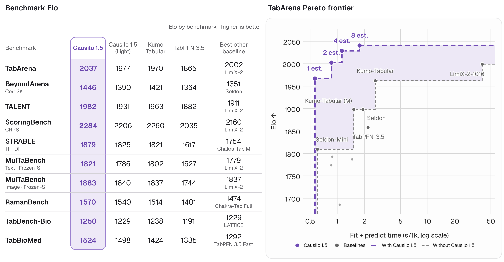

<h1 align="center">
  <picture>
    <source media="(max-width: 640px)" srcset="docs/assets/causilo-banner-compact.png">
    
  </picture>
</h1>

<p align="center">Tabular classification and regression with a scikit-learn API.</p>

<p align="center">
  <a href="https://pypi.org/project/causilo/"></a>
  <a href="#documentation"></a>
  <a href="https://arxiv.org/abs/2609.22866"></a>
  <br>
  <a href="#license"></a>
  <a href="https://nums.world/"></a>
  <a href="#installation"></a>
  <a href="#installation"></a>
</p>

## Quick start

### Installation

Install [Causilo from PyPI](https://pypi.org/project/causilo/).

```sh
pip install causilo
```

If you already have Causilo, upgrade with `pip install --upgrade causilo`.

The first `fit` downloads the [public Causilo 1.5 checkpoint](https://huggingface.co/nums-ai/causilo-1.5) for the estimator's task. No Hugging Face account is required.

### Classification

```python
from causilo import CausiloClassifier

clf = CausiloClassifier()
clf.fit(X_train, y_train)
labels = clf.predict(X_test)
```

### Regression

```python
from causilo import CausiloRegressor

reg = CausiloRegressor()
reg.fit(X_train, y_train)
predictions = reg.predict(X_test)
```

**Causilo 1.5** uses the full training context by default. Set `mode="light"`
on either estimator for **Causilo 1.5 (Light)**. To sample from larger tables,
set `max_context=200_000`. Set `model_version="1.0"` to use **Causilo 1.0**.

`fit` prepares preprocessing and an inference context from your labeled table. `predict` uses that context with fixed model weights.

## Benchmarks



Both frontiers use one Elo fit across all 816 official splits, with 112 official models and four Causilo settings. The chart shows the ten official peers with published timings. Causilo times were measured on RTX PRO 6000 with KV cache off. Peer totals are estimated from published per-dataset timings and use the peers’ own cache settings. The table’s TabArena scores compare Default and Light together.

[Pareto data](https://huggingface.co/nums-ai/causilo-1.5/blob/4ca2275bae85014a19422e8c18fcf8f24c5c14e1/benchmarks/tabarena/pareto-comparison.csv) · [Detailed results and evaluation protocols](https://huggingface.co/nums-ai/causilo-1.5/blob/4ca2275bae85014a19422e8c18fcf8f24c5c14e1/benchmarks/README.md)

## Documentation

[Python inference](docs/inference.md) · [Checkpoints](docs/checkpoints.md) · [Examples](examples/)

## License

Code is licensed under [Apache-2.0](LICENSE).

Causilo 1.5 weights are licensed under the [Nums AI Model License](https://huggingface.co/nums-ai/causilo-1.5/blob/4ca2275bae85014a19422e8c18fcf8f24c5c14e1/LICENSE).

## Citation

If you use Causilo in research, please cite:

```bibtex
@misc{cho2026causilotechnicalreport,
  title={Causilo Technical Report},
  author={Minyong Cho and Minho Jeong and Dooho Lee and Jinmo Lee and Jaemin Yoo},
  year={2026},
  eprint={2609.22866},
  archivePrefix={arXiv},
  primaryClass={cs.LG},
  url={https://arxiv.org/abs/2609.22866},
}
```
